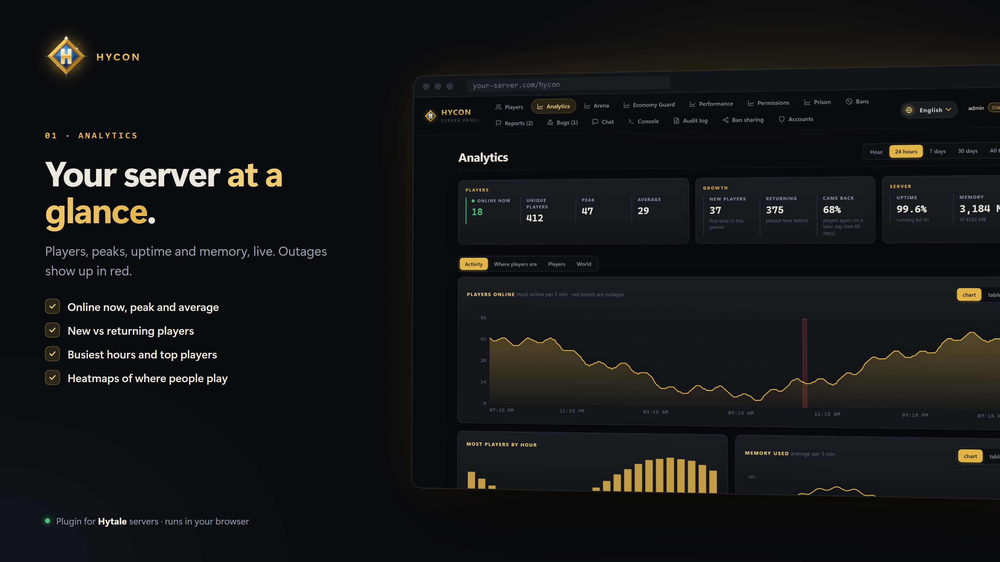
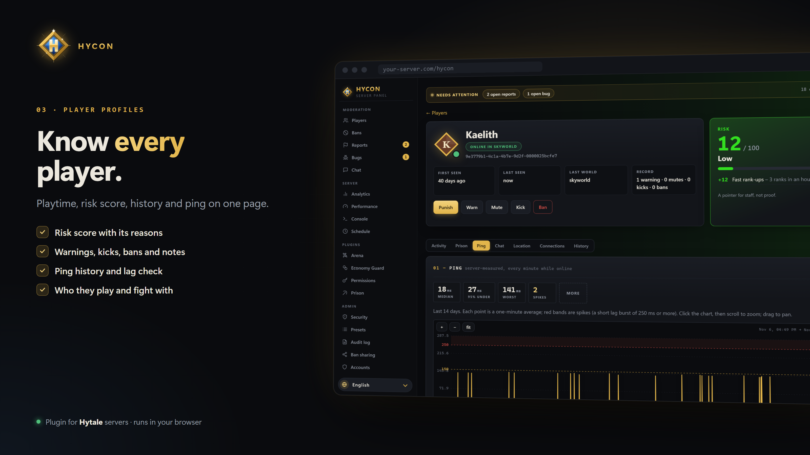

# Hycon

🌐 [English](README.md) · **Deutsch** · [Español](README.es.md) · [Français](README.fr.md) · [Italiano](README.it.md) · [Nederlands](README.nl.md) · [Polski](README.pl.md) · [Português](README.pt.md) · [Русский](README.ru.md) · [Türkçe](README.tr.md)

Ein Web-Adminpanel (wie RCON) für Hytale-Server, das als Server-Plugin läuft. Öffne es im Browser
auf demselben Rechner: Sieh, wer online ist, kicke, banne und entbanne (zeitlich begrenzt oder dauerhaft,
mit Grund), führe Konsolenbefehle aus, verfolge das Live-Log und sieh dir Dashboards anderer Plugins an.
Das Panel funktioniert auch auf dem Handy.

**Gemieteter Server?** Leg das Panel auf deine eigene Domain (`https://panel.deinedomain.de`) und öffne es
in jedem Browser: [docs/WEB-PANEL.md](docs/WEB-PANEL.md) (Englisch).

**Vollständige Anleitung: [docs/GUIDE.md](docs/GUIDE.md)** (Englisch: Installation, erster Login, jeder Tab,
Team-Accounts, alle Einstellungen, Fernzugriff über HTTPS, Fehlerbehebung). Das Panel selbst gibt es in
10 Sprachen; wähle sie oben rechts.

## Screenshots

| | |
|---|---|
|  |  |
|  |  |
|  |  |
|  | |

## Funktionen

- **Spieler**: wer online ist und wo, dazu ein durchsuchbares Verzeichnis aller, die je beigetreten sind.
- **Moderation**: verwarnen, kicken, bannen (zeitlich oder dauerhaft, mit Grund) und entbannen. Jeder Spieler hat
  eine **Akte** mit Verwarnungen, Kicks, Banns und Team-Notizen.
- **Spielerprofile**: Spielzeit, Sitzungen, Aktivität pro Tag und Stunde, PvP-Kills und -Tode, Akte und
  Bereiche, die andere Plugins hinzufügen.
- **Risikowert**: jedes Profil hat einen Wert von 0 bis 100 aus Verwarnungen, Kicks, Banns, Meldungen,
  geteilten Verbindungen und neuen Accounts. Jeder Punkt wird mit Grund aufgeführt. Alte Einträge verblassen, und
  Moderatoren können Fehlalarme mit **Risiko zurücksetzen** löschen.
- **Meldungen und Zweitaccounts**: Spielermeldungen zum Abarbeiten und Accounts, die über die Verbindung verknüpft sind.
- **Fehlerberichte**: Spieler senden sie im Spiel mit `/bug`; das Team liest und schließt sie im Panel.
- **Chatverlauf**: ein Chat-Tab mit allem, was Spieler geschrieben haben (Suche, 14 Tage).
- **Konsole**: das Live-Server-Log und Konsolenbefehle für Admins (mit Liste gesperrter Befehle).
- **Analytics**: Spielerzahlen, Ping, Aktivität und Dashboards anderer Plugins.
- **Leistungs-Profiler**: immer an und sparsam (deutlich unter 1 %). Zeigt, welche Plugins die meiste Serverzeit
  brauchen, jeden Lag-Spike mit Ursache und Plugins, die die Welt mit Datei- oder Datenbankzugriffen blockieren.
  `/lag` im Spiel, Warnungen an das Team und Discord.
- **Spieler-Globus**: ein 3D-Globus mit einem Punkt pro Spieler (nach Ping gefärbt); Profile warnen, wenn der Ping
  für die Entfernung zu niedrig ist (wahrscheinlich ein VPN).
- **Panel auf deiner eigenen Domain**: über HTTPS von überall erreichbar, auch bei gemieteten Servern.
- **Bann-Teilen** zwischen Servern und ein vollständiges **Audit-Log** aller Team-Aktionen.
- **Angemeldet bleiben**: 30 Tage automatischer Login, auch über Server-Neustarts.
- **Immer aktuell**: offene Seiten aktualisieren sich selbst und laden neu, wenn Hycon aktualisiert wird.

## Installation

Lege `Hycon-x.y.z.jar` in den `mods`-Ordner des Servers und starte ihn. Hycon erstellt `hycon.json`
(kommentierte Einstellungen) und den Standard-Account:

| Account | Passwort |
|---------|----------|
| `root`  | `hycon`  |

Öffne `http://127.0.0.1:8096/` **auf dem Server-Rechner**, melde dich damit an und wähle ein neues Passwort; vorher
erlaubt das Panel nichts anderes. Solange es nicht geändert ist, funktioniert das Standardpasswort nur auf dem
Server-Rechner selbst. Leg dann im Tab **Accounts** Zugänge für dein Team an.

Ausgesperrt? In der Serverkonsole: `/hycon resetpassword <name>` schreibt ein neues Passwort in `FIRST-LOGIN.txt`.

## Updates

Hycon prüft beim Start und alle 6 Stunden, ob es ein neueres Release auf GitHub gibt. Dann steht eine Warnung in der
Konsole, und Admins (Operatoren oder alle mit `hycon.updates.notify`) bekommen beim Beitreten eine Chatzeile mit dem Link.

## Bann-Teilen

Owner können Bannlisten zwischen Servern mit Hycon teilen (zum Beispiel eine netzwerkweite Bannliste). Jeder Server
erstellt einen Teilen-Code für die anderen; wer einem Code folgt, übernimmt alle 2 Minuten die Banns dieses Servers und hebt
sie auf, wenn sie dort aufgehoben werden. Lokale Banns werden nie angefasst, und Codes werden nie übers Netz gesendet.

## Account-Stufen

| Stufe     | Darf                                                           |
|-----------|----------------------------------------------------------------|
| VIEWER    | Spieler, Banns und Plugin-Dashboards sehen                     |
| MODERATOR | + kicken, bannen, entbannen, Live-Konsole lesen                |
| ADMIN     | + Konsolenbefehle ausführen, Audit-Log lesen                   |
| OWNER     | + Panel-Accounts verwalten, Logdateien herunterladen           |

## Sicherheit

- Das Panel hört standardmäßig **nur auf 127.0.0.1**. Für Zugriff von außen gehört ein HTTPS-Reverse-Proxy davor
  (siehe [docs/WEB-PANEL.md](docs/WEB-PANEL.md)).
- Passwörter werden als PBKDF2-SHA256-Hashes (600.000 Runden) gespeichert.
- Sitzungen nutzen HttpOnly- und SameSite=Strict-Cookies, jeder POST braucht ein CSRF-Token, und fehlgeschlagene
  Logins werden begrenzt.
- Jeder Login, Kick, Bann, Befehl und jede Account-Änderung landet im `audit.log`.
- `BlockedCommands` in `hycon.json` listet Befehle, die das Panel auch für ADMIN ablehnt.

Banns nutzen Hytales eigene Bannliste (`bans.json`, wie `/ban`), also setzt der Server sie durch.

## Für Plugin-Entwickler

Eigene Tabs, Profilbereiche, Formulare und Risikogründe: siehe die [englische README](README.md#for-plugin-developers-adding-a-dashboard)
und [docs/ADDING-A-PANEL.md](docs/ADDING-A-PANEL.md).
