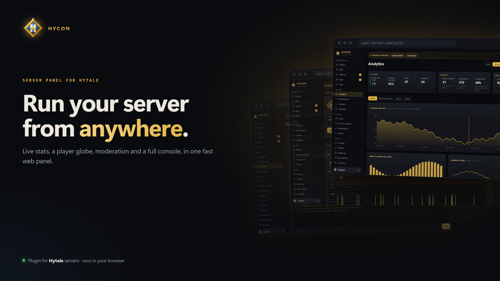

# Hycon

🌐 [English](README.md) · [Deutsch](README.de.md) · **Español** · [Français](README.fr.md) · [Italiano](README.it.md) · [Nederlands](README.nl.md) · [Polski](README.pl.md) · [Português](README.pt.md) · [Русский](README.ru.md) · [Türkçe](README.tr.md)

Un panel de administración web (estilo RCON) para servidores de Hytale, que funciona como plugin del servidor. Ábrelo en
el navegador del mismo equipo: mira quién está conectado, expulsa, banea y desbanea (temporal o permanente, con motivo),
ejecuta comandos de consola, sigue el registro en directo y consulta los paneles que añaden otros plugins.
El panel también funciona en el móvil.

**¿Servidor alquilado?** Pon el panel en tu propio dominio (`https://panel.tudominio.com`) y ábrelo desde cualquier
navegador: [docs/WEB-PANEL.md](docs/WEB-PANEL.md) (en inglés).

**Guía completa: [docs/GUIDE.md](docs/GUIDE.md)** (en inglés: instalación, primer inicio de sesión, cada pestaña,
cuentas del staff, todos los ajustes, acceso remoto por HTTPS, solución de problemas). El panel está disponible en
10 idiomas; elígelo arriba a la derecha.

## Capturas

| | |
|---|---|
|  |  |
|  |  |
|  |  |
|  | |

## Funciones

- **Jugadores**: quién está conectado y dónde, más un directorio con búsqueda de todos los que han entrado alguna vez.
- **Moderación**: advertir, expulsar, banear (temporal o permanente, con motivo) y desbanear. Cada jugador tiene un
  **historial** de advertencias, expulsiones, baneos y notas del staff.
- **Perfiles**: tiempo de juego, sesiones, actividad por día y por hora, bajas y muertes PvP, historial y secciones
  de otros plugins.
- **Puntuación de riesgo**: cada perfil tiene un valor de 0 a 100 basado en advertencias, expulsiones, baneos,
  reportes, conexiones compartidas y cuentas nuevas. Cada punto aparece con su motivo. Lo antiguo pierde peso, y los
  moderadores pueden usar **Borrar riesgo** ante falsos positivos.
- **Reportes y multicuentas**: reportes de jugadores para gestionar y cuentas vinculadas por conexión.
- **Reportes de errores**: los jugadores los envían en el juego con `/bug`; el staff los lee y cierra en el panel.
- **Historial de chat**: una pestaña Chat con todo lo que escribieron los jugadores (búsqueda, 14 días).
- **Consola**: el registro del servidor en directo y comandos para administradores (con lista de comandos bloqueados).
- **Estadísticas**: jugadores, ping, actividad y paneles de otros plugins.
- **Perfilador de rendimiento**: siempre activo y ligero (muy por debajo del 1 %). Muestra qué plugins usan más
  tiempo del servidor, cada pico de lag con su causa y los plugins que bloquean el mundo con archivos o bases de datos.
  `/lag` en el juego, alertas al staff y a Discord.
- **Globo de jugadores**: un globo 3D con un punto por jugador (coloreado según el ping); los perfiles avisan cuando
  el ping es demasiado bajo para la distancia (probablemente una VPN).
- **Panel en tu propio dominio**: accesible por HTTPS desde cualquier lugar, incluso con servidores alquilados.
- **Baneos compartidos** entre servidores y un **registro de auditoría** completo de las acciones del staff.
- **Recordarme**: inicio de sesión automático durante 30 días, incluso tras reinicios del servidor.
- **Siempre al día**: las páginas abiertas se actualizan solas y se recargan cuando Hycon se actualiza.

## Instalación

Pon `Hycon-x.y.z.jar` en la carpeta `mods` del servidor e inícialo. Hycon crea `hycon.json` (ajustes comentados) y la
cuenta por defecto:

| Cuenta | Contraseña |
|--------|------------|
| `root` | `hycon`    |

Abre `http://127.0.0.1:8096/` **en el equipo del servidor**, inicia sesión con esos datos y elige una contraseña nueva;
hasta entonces el panel no permite nada más. Mientras no la cambies, la contraseña por defecto solo funciona desde el
propio equipo del servidor. Después crea cuentas para tu staff en la pestaña **Accounts**.

¿Sin acceso? En la consola del servidor: `/hycon resetpassword <nombre>` escribe una contraseña nueva en `FIRST-LOGIN.txt`.

## Actualizaciones

Hycon comprueba si hay una versión nueva en GitHub al arrancar y cada 6 horas. Si la hay, avisa en la consola, y los
administradores (operadores o quien tenga `hycon.updates.notify`) reciben un mensaje con el enlace al entrar.

## Baneos compartidos

Los dueños pueden compartir listas de baneos entre servidores con Hycon (por ejemplo, una lista para toda una red). Cada
servidor crea un código para los demás; quien sigue un código importa los baneos de ese servidor cada 2 minutos y los
levanta cuando allí se levantan. Los baneos locales nunca se tocan y los códigos nunca se envían por la red.

## Niveles de cuenta

| Nivel     | Puede                                                          |
|-----------|----------------------------------------------------------------|
| VIEWER    | ver jugadores, baneos y paneles de plugins                     |
| MODERATOR | + expulsar, banear, desbanear, leer la consola en directo      |
| ADMIN     | + ejecutar comandos de consola, leer el registro de auditoría  |
| OWNER     | + crear, cambiar y eliminar cuentas del panel                  |

## Seguridad

- Por defecto el panel solo escucha en **127.0.0.1**. Para acceder desde fuera, pon delante un proxy inverso HTTPS
  (ver [docs/WEB-PANEL.md](docs/WEB-PANEL.md)).
- Las contraseñas se guardan como hashes PBKDF2-SHA256 (600.000 rondas).
- Las sesiones usan cookies HttpOnly y SameSite=Strict, cada POST necesita un token CSRF y los inicios de sesión
  fallidos están limitados.
- Cada inicio de sesión, expulsión, baneo, comando y cambio de cuenta queda en `audit.log`.
- `BlockedCommands` en `hycon.json` lista los comandos que el panel rechaza incluso para ADMIN.

Los baneos usan la lista propia de Hytale (`bans.json`, igual que `/ban`), así que el servidor los aplica.

## Para desarrolladores de plugins

Pestañas propias, secciones de perfil, formularios y motivos de riesgo: consulta el
[README en inglés](README.md#for-plugin-developers-adding-a-dashboard) y [docs/ADDING-A-PANEL.md](docs/ADDING-A-PANEL.md).
