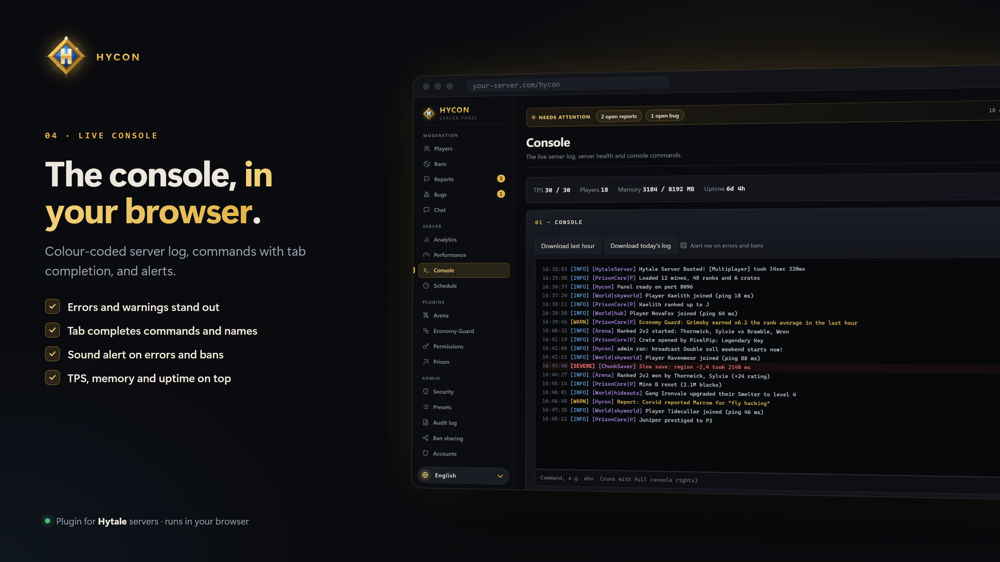
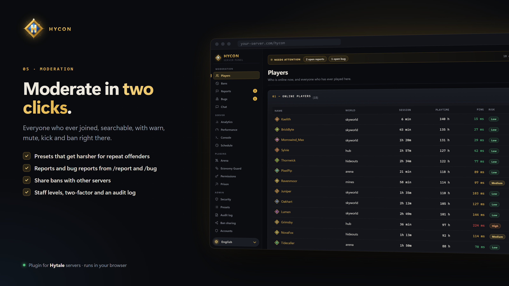

# Hycon

🌐 [English](README.md) · [Deutsch](README.de.md) · [Español](README.es.md) · **Français** · [Italiano](README.it.md) · [Nederlands](README.nl.md) · [Polski](README.pl.md) · [Português](README.pt.md) · [Русский](README.ru.md) · [Türkçe](README.tr.md)

Un panneau d'administration web (façon RCON) pour les serveurs Hytale, qui tourne comme plugin du serveur. Ouvrez-le dans
un navigateur sur la même machine : voyez qui est connecté, expulsez, bannissez et débannissez (temporairement ou
définitivement, avec un motif), lancez des commandes console, suivez le journal en direct et consultez les tableaux de
bord ajoutés par d'autres plugins. Le panneau fonctionne aussi sur téléphone.

**Serveur loué ?** Mettez le panneau sur votre propre domaine (`https://panel.votredomaine.fr`) et ouvrez-le depuis
n'importe quel navigateur : [docs/WEB-PANEL.md](docs/WEB-PANEL.md) (en anglais).

**Guide complet : [docs/GUIDE.md](docs/GUIDE.md)** (en anglais : installation, première connexion, chaque onglet,
comptes du staff, tous les réglages, accès distant en HTTPS, dépannage). Le panneau existe en 10 langues ; choisissez-la
en haut à droite.

## Captures d'écran

| | |
|---|---|
|  |  |
|  |  |
|  |  |
|  | |

## Fonctionnalités

- **Joueurs** : qui est connecté et où, plus un annuaire consultable de tous ceux qui ont déjà rejoint.
- **Modération** : avertir, expulser, bannir (temporairement ou définitivement, avec motif) et débannir. Chaque joueur a
  un **dossier** d'avertissements, d'expulsions, de bannissements et de notes du staff.
- **Profils** : temps de jeu, sessions, activité par jour et par heure, éliminations et morts PvP, dossier et sections
  ajoutées par d'autres plugins.
- **Score de risque** : chaque profil a une note de 0 à 100 calculée à partir des avertissements, expulsions,
  bannissements, signalements, connexions partagées et comptes récents. Chaque point est listé avec sa raison. Les
  anciens éléments s'estompent, et les modérateurs peuvent **Effacer le risque** en cas de faux positif.
- **Signalements et doubles comptes** : signalements de joueurs à traiter et comptes liés par la connexion.
- **Rapports de bugs** : les joueurs les envoient en jeu avec `/bug` ; le staff les lit et les ferme dans le panneau.
- **Historique du chat** : un onglet Chat avec tout ce que les joueurs ont écrit (recherche, 14 jours).
- **Console** : le journal du serveur en direct et les commandes pour les admins (avec une liste de commandes bloquées).
- **Statistiques** : nombre de joueurs, ping, activité et tableaux de bord d'autres plugins.
- **Profileur de performances** : toujours actif et léger (bien moins de 1 %). Montre quels plugins utilisent le plus le
  serveur, chaque pic de lag avec sa cause et les plugins qui bloquent le monde avec des fichiers ou une base de données.
  `/lag` en jeu, alertes au staff et sur Discord.
- **Globe des joueurs** : un globe 3D avec un point par joueur (coloré selon le ping) ; les profils signalent un ping
  trop faible pour la distance (probablement un VPN).
- **Panneau sur votre propre domaine** : accessible en HTTPS de partout, même avec un serveur loué.
- **Partage de bannissements** entre serveurs et un **journal d'audit** complet des actions du staff.
- **Se souvenir de moi** : connexion automatique pendant 30 jours, même après un redémarrage du serveur.
- **Toujours à jour** : les pages ouvertes se rafraîchissent seules et se rechargent quand Hycon est mis à jour.

## Installation

Placez `Hycon-x.y.z.jar` dans le dossier `mods` du serveur et démarrez-le. Hycon crée `hycon.json` (réglages commentés)
et le compte par défaut :

| Compte | Mot de passe |
|--------|--------------|
| `root` | `hycon`      |

Ouvrez `http://127.0.0.1:8096/` **sur la machine du serveur**, connectez-vous et choisissez un nouveau mot de passe ;
le panneau n'autorise rien d'autre avant. Tant qu'il n'est pas changé, le mot de passe par défaut ne fonctionne que
depuis la machine du serveur. Créez ensuite les comptes de votre staff dans l'onglet **Accounts**.

Bloqué ? Dans la console du serveur : `/hycon resetpassword <nom>` écrit un nouveau mot de passe dans `FIRST-LOGIN.txt`.

## Mises à jour

Hycon vérifie au démarrage et toutes les 6 heures si une nouvelle version est sur GitHub. Si oui, un avertissement
apparaît dans la console, et les admins (opérateurs ou toute personne avec `hycon.updates.notify`) reçoivent le lien
dans le chat en se connectant.

## Partage de bannissements

Les propriétaires peuvent partager leurs listes de bannissements entre serveurs Hycon (par exemple pour tout un réseau).
Chaque serveur crée un code pour les autres ; suivre un code importe les bannissements de ce serveur toutes les
2 minutes et les lève quand ils y sont levés. Les bannissements locaux ne sont jamais touchés et les codes ne passent
jamais par le réseau.

## Niveaux de compte

| Niveau    | Peut                                                           |
|-----------|----------------------------------------------------------------|
| VIEWER    | voir les joueurs, les bannissements et les tableaux de bord    |
| MODERATOR | + expulser, bannir, débannir, lire la console en direct        |
| ADMIN     | + lancer des commandes console, lire le journal d'audit        |
| OWNER     | + gérer les comptes du panneau, télécharger les logs           |

## Sécurité

- Par défaut, le panneau n'écoute que sur **127.0.0.1**. Pour y accéder de l'extérieur, placez un proxy inverse HTTPS
  devant (voir [docs/WEB-PANEL.md](docs/WEB-PANEL.md)).
- Les mots de passe sont stockés en hachages PBKDF2-SHA256 (600 000 itérations).
- Les sessions utilisent des cookies HttpOnly et SameSite=Strict, chaque POST exige un jeton CSRF et les échecs de
  connexion sont limités.
- Chaque connexion, expulsion, bannissement, commande et modification de compte est inscrit dans `audit.log`.
- `BlockedCommands` dans `hycon.json` liste les commandes que le panneau refuse même aux ADMIN.

Les bannissements utilisent la liste de Hytale (`bans.json`, comme `/ban`) : c'est le serveur qui les applique.

## Pour les développeurs de plugins

Onglets, sections de profil, formulaires et raisons de risque : voir le
[README en anglais](README.md#for-plugin-developers-adding-a-dashboard) et [docs/ADDING-A-PANEL.md](docs/ADDING-A-PANEL.md).
