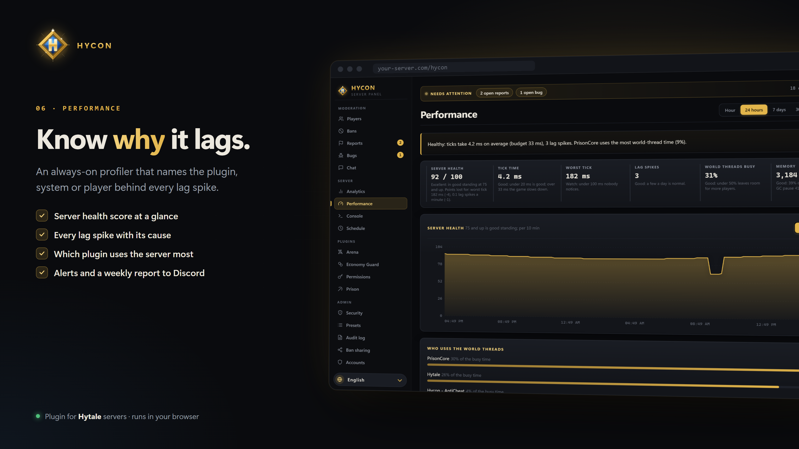

# Hycon

🌐 [English](README.md) · [Deutsch](README.de.md) · [Español](README.es.md) · [Français](README.fr.md) · [Italiano](README.it.md) · **Nederlands** · [Polski](README.pl.md) · [Português](README.pt.md) · [Русский](README.ru.md) · [Türkçe](README.tr.md)

Een webbeheerpaneel (zoals RCON) voor Hytale-servers, dat als serverplugin draait. Open het in een browser op dezelfde
computer: zie wie er online is, kick, ban en unban (tijdelijk of permanent, met een reden), voer consolecommando's uit,
volg het live logboek en bekijk dashboards van andere plugins. Het paneel werkt ook op je telefoon.

**Gehuurde server?** Zet het paneel op je eigen domein (`https://panel.jouwdomein.nl`) en open het in elke browser:
[docs/WEB-PANEL.md](docs/WEB-PANEL.md) (Engels).

**Volledige handleiding: [docs/GUIDE.md](docs/GUIDE.md)** (Engels: installatie, eerste keer inloggen, elk tabblad,
staffaccounts, alle instellingen, toegang op afstand via HTTPS, problemen oplossen). Het paneel zelf is er in 10 talen;
kies rechtsboven.

## Schermafbeeldingen

| | |
|---|---|
|  |  |
|  |  |
|  |  |
|  | |

## Functies

- **Spelers**: wie er online is en waar, plus een doorzoekbare lijst van iedereen die ooit heeft gespeeld.
- **Moderatie**: waarschuwen, kicken, bannen (tijdelijk of permanent, met reden) en unbannen. Elke speler heeft een
  **dossier** met waarschuwingen, kicks, bans en staffnotities.
- **Profielen**: speeltijd, sessies, activiteit per dag en per uur, PvP-kills en -doden, dossier en onderdelen van
  andere plugins.
- **Risicoscore**: elk profiel krijgt een score van 0 tot 100 op basis van waarschuwingen, kicks, bans, meldingen,
  gedeelde verbindingen en nieuwe accounts. Elk punt staat erbij met de reden. Oude zaken tellen steeds minder, en
  moderators kunnen bij een vals alarm **Risico wissen**.
- **Meldingen en alts**: spelersmeldingen om af te handelen en accounts die via de verbinding gekoppeld zijn.
- **Bugmeldingen**: spelers sturen ze in het spel met `/bug`; de staff leest en sluit ze in het paneel.
- **Chatgeschiedenis**: een Chat-tabblad met alles wat spelers zeiden (zoeken, 14 dagen).
- **Console**: het live serverlogboek en consolecommando's voor admins (met een lijst geblokkeerde commando's).
- **Statistieken**: spelersaantallen, ping, activiteit en dashboards van andere plugins.
- **Prestatieprofiler**: altijd aan en licht (ruim onder 1 %). Laat zien welke plugins de meeste servertijd gebruiken,
  elke lagpiek met de oorzaak en plugins die de wereld blokkeren met bestanden of een database. `/lag` in het spel,
  meldingen aan de staff en op Discord.
- **Spelerswereldbol**: een 3D-wereldbol met een stip per speler (gekleurd op ping); profielen waarschuwen als de ping
  te laag is voor de afstand (waarschijnlijk een VPN).
- **Paneel op je eigen domein**: overal bereikbaar via HTTPS, ook bij een gehuurde server.
- **Bans delen** tussen servers en een volledig **auditlogboek** van alles wat de staff doet.
- **Onthoud mij**: 30 dagen automatisch inloggen, ook na een herstart van de server.
- **Altijd actueel**: open pagina's verversen zichzelf en laden opnieuw als Hycon is bijgewerkt.

## Installatie

Zet `Hycon-x.y.z.jar` in de map `mods` van de server en start hem. Hycon maakt `hycon.json` (instellingen met uitleg)
en het standaardaccount aan:

| Account | Wachtwoord |
|---------|------------|
| `root`  | `hycon`    |

Open `http://127.0.0.1:8096/` **op de servercomputer**, log daarmee in en kies een nieuw wachtwoord; daarvoor staat het
paneel niets anders toe. Zolang het niet is gewijzigd, werkt het standaardwachtwoord alleen op de servercomputer zelf.
Maak daarna accounts voor je staff aan in het tabblad **Accounts**.

Buitengesloten? In de serverconsole: `/hycon resetpassword <naam>` schrijft een nieuw wachtwoord naar `FIRST-LOGIN.txt`.

## Updates

Hycon kijkt bij het opstarten en elke 6 uur of er een nieuwere release op GitHub staat. Zo ja, dan staat er een
waarschuwing in de console, en admins (operators of iedereen met `hycon.updates.notify`) krijgen bij het joinen de link in de chat.

## Bans delen

Eigenaren kunnen banlijsten delen tussen servers met Hycon (bijvoorbeeld één banlijst voor een heel netwerk). Elke server
maakt een deelcode voor de anderen; wie een code volgt, neemt elke 2 minuten de bans van die server over en heft ze op
als ze daar worden opgeheven. Lokale bans worden nooit aangeraakt en codes gaan nooit over het netwerk.

## Accountniveaus

| Niveau    | Mag                                                            |
|-----------|----------------------------------------------------------------|
| VIEWER    | spelers, bans en plugindashboards bekijken                     |
| MODERATOR | + kicken, bannen, unbannen, de live console lezen              |
| ADMIN     | + consolecommando's uitvoeren, het auditlogboek lezen          |
| OWNER     | + paneelaccounts beheren, logbestanden downloaden              |

## Beveiliging

- Standaard luistert het paneel **alleen op 127.0.0.1**. Voor toegang van buitenaf zet je er een HTTPS-reverse-proxy
  voor (zie [docs/WEB-PANEL.md](docs/WEB-PANEL.md)).
- Wachtwoorden worden opgeslagen als PBKDF2-SHA256-hashes (600.000 rondes).
- Sessies gebruiken HttpOnly- en SameSite=Strict-cookies, elke POST vraagt een CSRF-token en mislukte inlogpogingen
  worden beperkt.
- Elke login, kick, ban, elk commando en elke accountwijziging komt in `audit.log`.
- `BlockedCommands` in `hycon.json` noemt commando's die het paneel zelfs voor ADMIN weigert.

Bans gebruiken de eigen banlijst van Hytale (`bans.json`, net als `/ban`), dus de server handhaaft ze.

## Voor pluginontwikkelaars

Eigen tabbladen, profielonderdelen, formulieren en risicoredenen: zie de
[Engelse README](README.md#for-plugin-developers-adding-a-dashboard) en [docs/ADDING-A-PANEL.md](docs/ADDING-A-PANEL.md).
