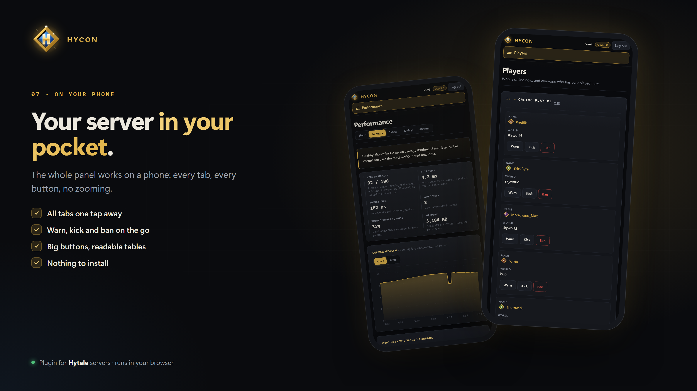

# Hycon

🌐 [English](README.md) · [Deutsch](README.de.md) · [Español](README.es.md) · [Français](README.fr.md) · [Italiano](README.it.md) · [Nederlands](README.nl.md) · [Polski](README.pl.md) · **Português** · [Русский](README.ru.md) · [Türkçe](README.tr.md)

Um painel de administração web (estilo RCON) para servidores de Hytale, que roda como plugin do servidor. Abra no
navegador da mesma máquina: veja quem está online, expulse, bana e desbana (temporário ou permanente, com motivo),
execute comandos do console, acompanhe o log ao vivo e veja os painéis que outros plugins adicionam.
O painel também funciona no celular.

**Servidor alugado?** Coloque o painel no seu próprio domínio (`https://painel.seudominio.com.br`) e abra em qualquer
navegador: [docs/WEB-PANEL.md](docs/WEB-PANEL.md) (em inglês).

**Guia completo: [docs/GUIDE.md](docs/GUIDE.md)** (em inglês: instalação, primeiro login, cada aba, contas da equipe,
todas as configurações, acesso remoto por HTTPS, solução de problemas). O painel está disponível em 10 idiomas;
escolha no canto superior direito.

## Capturas de tela

| | |
|---|---|
|  |  |
|  |  |
|  |  |
|  | |

## Recursos

- **Jogadores**: quem está online e onde, além de uma lista pesquisável de todos que já entraram.
- **Moderação**: advertir, expulsar, banir (temporário ou permanente, com motivo) e desbanir. Cada jogador tem uma
  **ficha** com advertências, expulsões, banimentos e notas da equipe.
- **Perfis**: tempo de jogo, sessões, atividade por dia e por hora, abates e mortes PvP, ficha e seções de outros plugins.
- **Pontuação de risco**: cada perfil tem uma nota de 0 a 100 baseada em advertências, expulsões, banimentos,
  denúncias, conexões compartilhadas e contas novas. Cada ponto aparece com o motivo. Registros antigos perdem peso, e
  moderadores podem usar **Limpar risco** em falsos alarmes.
- **Denúncias e contas alternativas**: denúncias de jogadores para resolver e contas ligadas pela conexão.
- **Relatórios de bugs**: os jogadores enviam no jogo com `/bug`; a equipe lê e fecha no painel.
- **Histórico do chat**: uma aba Chat com tudo o que os jogadores escreveram (busca, 14 dias).
- **Console**: o log do servidor ao vivo e comandos para admins (com lista de comandos bloqueados).
- **Estatísticas**: número de jogadores, ping, atividade e painéis de outros plugins.
- **Profiler de desempenho**: sempre ligado e leve (bem abaixo de 1 %). Mostra quais plugins usam mais tempo do
  servidor, cada pico de lag com a causa e os plugins que travam o mundo com arquivos ou banco de dados. `/lag` no jogo,
  alertas para a equipe e no Discord.
- **Globo de jogadores**: um globo 3D com um ponto por jogador (colorido pelo ping); os perfis avisam quando o ping é
  baixo demais para a distância (provavelmente uma VPN).
- **Painel no seu próprio domínio**: acessível por HTTPS de qualquer lugar, mesmo com servidor alugado.
- **Banimentos compartilhados** entre servidores e um **registro de auditoria** completo das ações da equipe.
- **Lembrar de mim**: login automático por 30 dias, mesmo após reiniciar o servidor.
- **Sempre atualizado**: páginas abertas se atualizam sozinhas e recarregam quando o Hycon é atualizado.

## Instalação

Coloque `Hycon-x.y.z.jar` na pasta `mods` do servidor e inicie-o. O Hycon cria o `hycon.json` (configurações
comentadas) e a conta padrão:

| Conta  | Senha   |
|--------|---------|
| `root` | `hycon` |

Abra `http://127.0.0.1:8096/` **na máquina do servidor**, entre com esses dados e escolha uma senha nova; antes disso o
painel não permite mais nada. Enquanto não for trocada, a senha padrão só funciona na própria máquina do servidor.
Depois crie contas para a sua equipe na aba **Accounts**.

Ficou sem acesso? No console do servidor: `/hycon resetpassword <nome>` grava uma senha nova em `FIRST-LOGIN.txt`.

## Atualizações

O Hycon verifica ao iniciar e a cada 6 horas se há uma versão nova no GitHub. Se houver, mostra um aviso no console, e
os admins (operadores ou quem tem `hycon.updates.notify`) recebem o link no chat ao entrar.

## Banimentos compartilhados

Os donos podem compartilhar listas de banimento entre servidores com Hycon (por exemplo, uma lista para toda uma rede).
Cada servidor cria um código para os outros; quem segue um código importa os banimentos desse servidor a cada 2 minutos
e os remove quando são removidos lá. Banimentos locais nunca são alterados e os códigos nunca trafegam pela rede.

## Níveis de conta

| Nível     | Pode                                                           |
|-----------|----------------------------------------------------------------|
| VIEWER    | ver jogadores, banimentos e painéis de plugins                 |
| MODERATOR | + expulsar, banir, desbanir, ler o console ao vivo             |
| ADMIN     | + executar comandos do console, ler o registro de auditoria    |
| OWNER     | + criar, alterar e remover contas do painel                    |

## Segurança

- Por padrão o painel escuta **apenas em 127.0.0.1**. Para acessar de fora, coloque um proxy reverso com HTTPS na frente
  (veja [docs/WEB-PANEL.md](docs/WEB-PANEL.md)).
- As senhas são salvas como hashes PBKDF2-SHA256 (600.000 rodadas).
- As sessões usam cookies HttpOnly e SameSite=Strict, todo POST exige um token CSRF e logins com falha são limitados.
- Todo login, expulsão, banimento, comando e alteração de conta vai para o `audit.log`.
- `BlockedCommands` no `hycon.json` lista comandos que o painel recusa até para ADMIN.

Os banimentos usam a lista do próprio Hytale (`bans.json`, igual ao `/ban`), então o servidor os aplica.

## Para desenvolvedores de plugins

Abas próprias, seções de perfil, formulários e motivos de risco: veja o
[README em inglês](README.md#for-plugin-developers-adding-a-dashboard) e [docs/ADDING-A-PANEL.md](docs/ADDING-A-PANEL.md).
