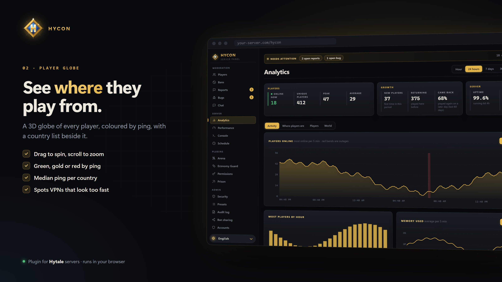

# Hycon

🌐 [English](README.md) · [Deutsch](README.de.md) · [Español](README.es.md) · [Français](README.fr.md) · [Italiano](README.it.md) · [Nederlands](README.nl.md) · [Polski](README.pl.md) · [Português](README.pt.md) · [Русский](README.ru.md) · **Türkçe**

Hytale sunucuları için sunucu eklentisi olarak çalışan bir web yönetim paneli (RCON tarzı). Aynı bilgisayardaki tarayıcıda
aç: kimin çevrimiçi olduğunu gör, oyuncuları at, yasakla ve yasağı kaldır (süreli veya kalıcı, sebebiyle), konsol
komutları çalıştır, canlı kaydı izle ve diğer eklentilerin eklediği panolara bak. Panel telefonda da çalışır.

**Kiralık sunucu mu?** Paneli kendi alan adına koy (`https://panel.alanadin.com`) ve herhangi bir tarayıcıdan aç:
[docs/WEB-PANEL.md](docs/WEB-PANEL.md) (İngilizce).

**Tam kılavuz: [docs/GUIDE.md](docs/GUIDE.md)** (İngilizce: kurulum, ilk giriş, her sekme, yetkili hesapları, tüm
ayarlar, HTTPS ile uzaktan erişim, sorun giderme). Panelin kendisi 10 dilde; dili sağ üstten seç.

## Ekran görüntüleri

| | |
|---|---|
|  |  |
|  |  |
|  |  |
|  | |

## Özellikler

- **Oyuncular**: kim çevrimiçi ve nerede, ayrıca şimdiye kadar katılan herkesin aranabilir listesi.
- **Moderasyon**: uyarma, atma, yasaklama (süreli veya kalıcı, sebebiyle) ve yasak kaldırma. Her oyuncunun uyarı, atılma,
  yasak ve yetkili notlarından oluşan bir **sicili** vardır.
- **Profiller**: oynama süresi, oturumlar, gün ve saate göre etkinlik, PvP öldürme ve ölümleri, sicil ve diğer
  eklentilerin bölümleri.
- **Risk puanı**: her profilin uyarılar, atılmalar, yasaklar, şikâyetler, ortak bağlantılar ve yeni hesaplardan oluşan
  0-100 arası bir puanı vardır. Her puan sebebiyle listelenir. Eski kayıtların etkisi zamanla azalır, moderatörler yanlış
  alarmlarda **Riski temizle** diyebilir.
- **Şikâyetler ve ikinci hesaplar**: ilgilenilecek oyuncu şikâyetleri ve bağlantı üzerinden bağlı hesaplar.
- **Hata raporları**: oyuncular oyunda `/bug` ile gönderir; yetkililer panelde okuyup kapatır.
- **Sohbet geçmişi**: oyuncuların yazdığı her şeyin olduğu bir Chat sekmesi (arama, 14 gün).
- **Konsol**: canlı sunucu kaydı ve yöneticiler için konsol komutları (engellenen komutlar listesiyle).
- **İstatistikler**: oyuncu sayıları, ping, etkinlik ve diğer eklentilerin panoları.
- **Performans profilleyici**: her zaman açık ve hafif (%1'in çok altında). Hangi eklentilerin sunucuyu en çok
  kullandığını, her lag sıçramasını sebebiyle ve dünyayı dosya ya da veritabanı işlemleriyle bekleten eklentileri
  gösterir. Oyunda `/lag`, yetkililere ve Discord'a uyarılar.
- **Oyuncu küresi**: her oyuncu için bir nokta olan 3D küre (pinge göre renkli); ping mesafeye göre fazla düşükse profil
  uyarır (büyük ihtimalle VPN).
- **Kendi alan adında panel**: kiralık sunucuda bile HTTPS ile her yerden erişilebilir.
- **Sunucular arası yasak paylaşımı** ve yetkili işlemlerinin eksiksiz **denetim kaydı**.
- **Beni hatırla**: sunucu yeniden başlasa bile 30 gün otomatik giriş.
- **Hep güncel**: açık sayfalar kendini yeniler ve Hycon güncellenince yeniden yüklenir.

## Kurulum

`Hycon-x.y.z.jar` dosyasını sunucunun `mods` klasörüne koy ve sunucuyu başlat. Hycon `hycon.json` dosyasını (açıklamalı
ayarlar) ve varsayılan hesabı oluşturur:

| Hesap  | Şifre   |
|--------|---------|
| `root` | `hycon` |

**Sunucu bilgisayarında** `http://127.0.0.1:8096/` adresini aç, bu bilgilerle giriş yap ve yeni bir şifre belirle;
o zamana kadar panel başka bir şeye izin vermez. Şifre değişene kadar varsayılan şifre yalnızca sunucu bilgisayarından
çalışır. Ardından **Accounts** sekmesinden yetkililerin için hesaplar oluştur.

Giremiyor musun? Sunucu konsolunda: `/hycon resetpassword <isim>` yeni bir şifreyi `FIRST-LOGIN.txt` dosyasına yazar.

## Güncellemeler

Hycon başlarken ve her 6 saatte bir GitHub'da yeni sürüm olup olmadığına bakar. Varsa konsola uyarı yazar, yöneticiler
(operatörler veya `hycon.updates.notify` izni olanlar) de girişte sohbette bağlantıyı görür.

## Yasak paylaşımı

Sahipler, Hycon kullanan sunucular arasında yasak listelerini paylaşabilir (örneğin tüm ağ için tek bir liste). Her sunucu
diğerleri için bir paylaşım kodu oluşturur; bir kodu takip eden sunucu, o sunucunun yasaklarını 2 dakikada bir alır ve
orada kaldırıldıklarında kaldırır. Yerel yasaklara asla dokunulmaz, kodlar ağ üzerinden asla gönderilmez.

## Hesap seviyeleri

| Seviye    | Yapabilir                                                      |
|-----------|----------------------------------------------------------------|
| VIEWER    | oyuncuları, yasakları ve eklenti panolarını görmek             |
| MODERATOR | + atmak, yasaklamak, yasak kaldırmak, canlı konsolu okumak     |
| ADMIN     | + konsol komutları çalıştırmak, denetim kaydını okumak         |
| OWNER     | + panel hesaplarını yönetmek, log dosyalarını indirmek         |

## Güvenlik

- Panel varsayılan olarak **yalnızca 127.0.0.1** üzerinde dinler. Dışarıdan erişim için önüne HTTPS'li bir ters proxy
  koy (bkz. [docs/WEB-PANEL.md](docs/WEB-PANEL.md)).
- Şifreler PBKDF2-SHA256 karmaları (600.000 tur) olarak saklanır.
- Oturumlar HttpOnly ve SameSite=Strict çerezleri kullanır, her POST bir CSRF jetonu ister ve başarısız girişler sınırlanır.
- Her giriş, atma, yasak, komut ve hesap değişikliği `audit.log` dosyasına yazılır.
- `hycon.json` içindeki `BlockedCommands`, panelin ADMIN için bile reddettiği komutları listeler.

Yasaklar Hytale'in kendi listesini (`bans.json`, `/ban` ile aynı) kullanır, yani sunucu onları uygular.

## Eklenti geliştiricileri için

Kendi sekmeler, profil bölümleri, formlar ve risk sebepleri için
[İngilizce README](README.md#for-plugin-developers-adding-a-dashboard) ve [docs/ADDING-A-PANEL.md](docs/ADDING-A-PANEL.md) dosyalarına bak.
